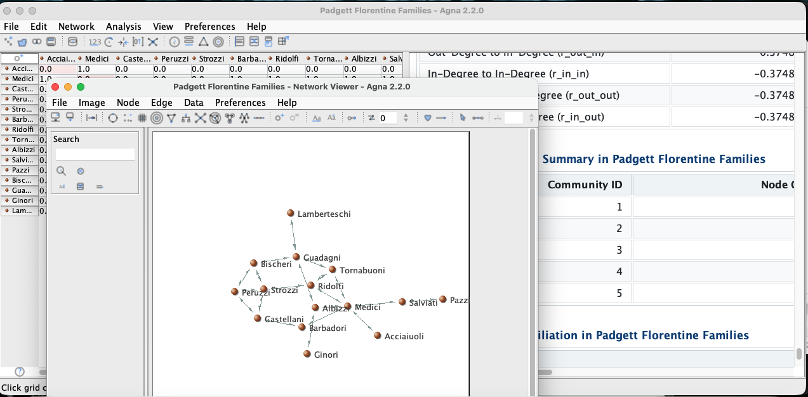

# AGNA

[](https://github.com/baeckett/AGNA/actions/workflows/ci.yml)
[](https://www.apache.org/licenses/LICENSE-2.0)



**AGNA — Applied Graph and Network Analysis Open Source** — is free desktop
and command-line software for **social network analysis, sociometry, and
sequential analysis**. It is designed for researchers, teachers, and students
who want to create, visualize, and analyze networks **without programming**.

Enter a sociomatrix in a spreadsheet-style grid, inspect it as a node/edge
graph, and run the classic measures: density, components, distances,
centrality, geodesics, shortest paths, cliques, and more. Networks import and
export in AGNA's own `.agn` format, plain text, CSV, Pajek `.net`, Excel
(`.xls`/`.xlsx`), GraphML, GML, and GraphSON; diagrams export to images and
vector graphics, and the command line renders networks headlessly for
reproducible workflows.

> If you just want to try it: see the
> [Quick Start](docs/QUICKSTART.md) or the
> [latest release](https://github.com/baeckett/AGNA/releases) for ready-made
> packages.

## Who is AGNA for?

AGNA is particularly suited to **small and medium research networks**:
communication, collaboration, affiliation, interaction, behavioral,
institutional, historical, and other relational data. It is used in
sociology, anthropology, communication research, psychology, education,
organizational research, animal-behavior studies, and the humanities. The
original author, [Marius Ion Bența](https://www.netanalysis.co.uk), [George Barițiu History Institute, Cluj](https://institutuldeistoriegeorgebaritiu.ro/), built it
(2001–2005) as a friendly alternative to programming environments; **2.2.2**
is the open-source release of that work, modernized and fully tested.

## The three components

| Component | Purpose | Primary audience |
|-----------|---------|------------------|
| **AGNA Desktop** | Graphical network creation, visualization, and analysis | Researchers, students, teachers |
| **AGNA Core** | Java library: network models, analyses, transformations, rendering, formats | Developers and research-software projects |
| **AGNA CLI** | Command-line analysis, reproducible workflows, diagram generation | Advanced users, scripts, automation |

```
AGNA Desktop ──────► AGNA Core ◄────── AGNA CLI
(graphical UI)         (engine)        (command line)
```

The components share one architecture: **Desktop** provides the graphical
interface, **Core** provides the reusable engine, and **CLI** exposes Core
functions for scripted, reproducible work. All three are released under the
**Apache License 2.0**.

## What you can do

- **Build networks** — create and edit directed, undirected, binary, and
  valued networks through matrices, tables, and graphical views.
- **Explore structure** — inspect density, components, distances, centrality,
  sociometric patterns, and other network properties.
- **Visualize relations** — use the integrated visual editor to arrange,
  inspect, and export readable network diagrams.
- **Teach and learn** — work with the bundled example networks
  (`samples/`) and the [user manual](docs/manual.md).
- **Automate** — repeat analyses from a terminal with AGNA CLI
  ([reference](docs/cli.md), `--help` lists every command).

## Use with AI Agents & LLMs

AGNA is built to be AI-agent and tool-call friendly:
- **Zero interactive prompts** — all operations run deterministically non-interactively and support standard input/output pipes (`-`).
- **Instant startup (7ms)** — pre-compiled standalone native machine code (`agna` / `agna.exe`) starts in ~7ms with zero Java prerequisites.
- **Model Context Protocol (MCP)** — native JSON-RPC 2.0 stdio server (`agna mcp`) directly integrable into Claude Desktop, Cursor, Antigravity, and Copilot.
- **Pre-flight data validation (`validate`)** — inspect graph syntax, dimensions, isolates, components, and self-loops with actionable diagnostics (`--json`).
- **Built-in metric dictionary (`explain`)** — retrieve definitions, formulas, and cautious interpretations for 37 SNA metrics directly in JSON.
- **Context-window protection (`metrics --top N`)** — get summary statistics (`mean`, `stdDev`, `min`, `max`) and top-N ranking nodes to conserve LLM tokens.
- **Topology-driven advisory (`advise`)** — AI agents can query Agna to recommend methodologically sound centrality measures, null models, and layout visualizers.
- **Agent documentation** — see [AGENTS.md](AGENTS.md) and [llms.txt](llms.txt) for recipes, schemas, and exit code reference.

## Quick start

The shortest path to a first analysis is the
[Quick Start](docs/QUICKSTART.md) — about ten minutes, using the bundled
`Example 1` network: open the file, inspect the graph, run the basic
measures, and export the results.

## Installation

### 1. Desktop Application
Installers bundle the Java runtime; no separate Java installation is
needed. Choose your platform from the
[latest release](https://github.com/baeckett/AGNA/releases):

- **macOS** — [AGNA-2.2.2.dmg](https://github.com/baeckett/AGNA/releases/download/v2.2.2/AGNA-2.2.2.dmg) (Drag to `/Applications`)
- **Windows** — [AGNA-2.2.2.exe](https://github.com/baeckett/AGNA/releases/download/v2.2.2/AGNA-2.2.2.exe) · [AGNA-2.2.2.msi](https://github.com/baeckett/AGNA/releases/download/v2.2.2/AGNA-2.2.2.msi)
- **Linux** — [Debian/Ubuntu .deb](https://github.com/baeckett/AGNA/releases/download/v2.2.2/agna_2.2.2-1_amd64.deb) · [Fedora/RHEL .rpm](https://github.com/baeckett/AGNA/releases/download/v2.2.2/agna-2.2.2-1.x86_64.rpm) · [portable archive](https://github.com/baeckett/AGNA/releases/download/v2.2.2/AGNA-2.2.2-Linux-x64.tar.gz)

#### Opening on macOS (Bypassing Gatekeeper Malware Warning)

Because AGNA is community open-source software and not signed with an annual commercial Apple Developer ID certificate, macOS Gatekeeper may display a prompt on the first launch saying:
> *"Apple could not verify “AGNA.app” is free of malware that may harm your Mac or compromise your privacy."*

This is standard macOS protection for files downloaded from the web. **You only need to bypass it once:**

* **Option 1 (System Settings — Recommended on macOS Sequoia & Sonoma):**
  1. Click **Done** on the alert dialogue.
  2. Open **System Settings ▸ Privacy & Security**.
  3. Scroll down to the **Security** section where you will see:  
     *“AGNA.app was blocked from use because it is not from an identified developer.”*
  4. Click **Open Anyway**, enter your Mac password / Touch ID, and click **Open**.
* **Option 2 (Right-Click in Finder):**
  1. In Finder, open `/Applications`.
  2. **Right-Click (or Control-Click)** `AGNA.app` and choose **Open**.
  3. In the prompt that appears, click the **Open** button.
* **Option 3 (Terminal One-Liner):**
  Remove the download quarantine attribute attached by your browser:
  ```bash
  xattr -cr /Applications/AGNA.app
  ```

Once confirmed via any of these options, macOS permanently remembers your choice and AGNA opens immediately on double-click.

### 2. Standalone Native CLI Binaries (Zero-Install, Single-File, ~7ms Startup)
For scripts, shell workflows, and AI coding agents, Agna CLI is provided as a **single standalone executable file** with **zero installation** and **zero Java requirements**:

* **macOS (Apple Silicon M1/M2/M3/M4):** `agna-macos-arm64.tar.gz`
* **macOS (Intel x86_64):** `agna-macos-x86_64.tar.gz`
* **Linux (x86_64):** `agna-linux-amd64.tar.gz`
* **Windows (x64):** `agna-windows-amd64.zip` (`agna.exe`)

You can run that single binary directly from any directory (`./agna <command>`). To make it accessible globally from anywhere, move it into your `$PATH` (e.g. `/usr/local/bin`):

```bash
# Quick install on macOS / Linux:
curl -sL https://github.com/baeckett/AGNA/releases/download/v2.2.2/agna-macos-arm64.tar.gz | tar -xz -C /usr/local/bin agna
agna --version
```

### 3. Portable JARs (Java 17+)
Users with Java 17+ can also run the self-contained JARs directly:
```bash
java -jar agna-desktop/target/agna-2.2.2.jar        # desktop
java -jar agna-cli/target/agna-cli-2.2.2.jar --help # CLI
```

### Build from source

Requires JDK 17+ and Maven:

```bash
mvn verify                               # compile + run full test suite
mvn package                              # build all JARs in target/
./tools/build-native-image.sh            # build standalone native binary (GraalVM)
```

On first start the bundled node-face images are materialized under
`~/.agna/faces`. All text I/O is UTF-8.

## Repository layout

```
agna-core/      engine: networks, analyses, layouts, import/export
agna-cli/       command-line interface (info, analyse, convert, transform,
                draw, generate, metrics, ...)
agna-desktop/   the desktop application (Swing)
samples/        original sample networks (kept byte-identical)
docs/           user manual, CLI reference, quick start, man page
packaging/      installer recipes (macOS dmg, icons), signing guide
CITATION.cff    machine-readable citation metadata (Zenodo DOI)
```

## License

Apache License 2.0 — see [LICENSE](LICENSE). No warranty; use at your own
discretion.

## High-Risk Activities Disclaimer

AGNA is provided for research, educational, and general analytical purposes.
It is not designed, developed, tested, certified, or intended for use in
hazardous or safety-critical environments requiring fail-safe performance.
Without limitation, AGNA must not be used for the design, construction,
operation, maintenance, monitoring, or control of nuclear facilities;
aircraft, aviation navigation, aviation communications, or air-traffic
control systems; direct life-support or life-critical medical systems;
weapons systems; emergency-response control systems; or any other activity in
which a failure, error, delay, interruption, or inaccurate output could
reasonably be expected to result in death, personal injury, or severe
physical, environmental, or property damage. Any use of AGNA in such high-risk
activities is entirely at the user’s own risk. To the maximum extent permitted
by applicable law, the author and contributors disclaim all warranties,
whether express, implied, statutory, or otherwise, including any warranty of
fitness for high-risk activities.

## Citation

If you use AGNA in your research, please cite it (see also
[CITATION.cff](CITATION.cff) and [CITATION.bib](CITATION.bib)):

> Bența, M. I. (2026). *AGNA: Applied Graph and Network Analysis Open Source*
> (Version 2.2.2) [Computer software]. https://doi.org/10.5281/zenodo.22708198

## Links

- Website: https://www.netanalysis.co.uk
- Contact: contact@netanalysis.co.uk
- Copyright 2001–2026 Marius Ion Bența
- [Changelog](CHANGELOG.md)
- [Acknowledgements](ACKNOWLEDGEMENTS.md)
