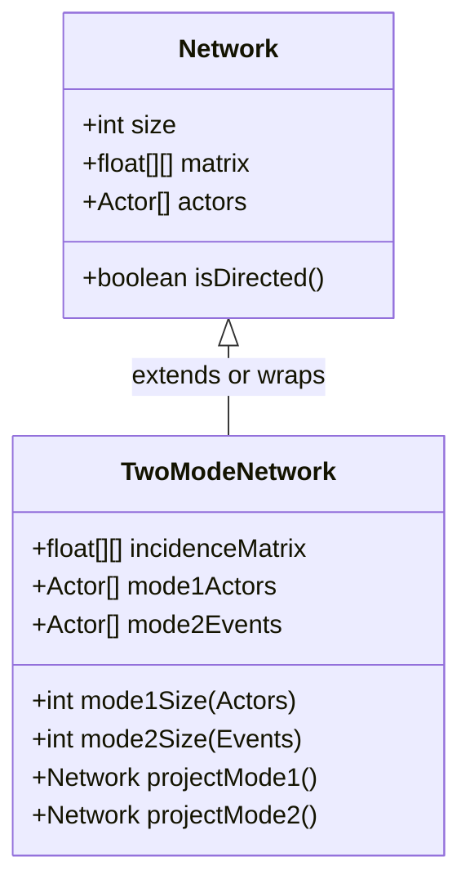

# Two-mode Networks

Here is the recommended architecture for introducing two-mode networks cleanly into Agna without breaking compatibility with existing single-mode algorithms:



#### A. Data Structures
1. **Class Architecture:**
   - **Option 1 (Subclassing / Wrapper):** Create `TwoModeNetwork extends Network` (or a dedicated `TwoModeNetwork` composition that wraps an underlying $(M + K) \times (M + K)$ block matrix). 
     $$\mathbf{A} = \begin{pmatrix} \mathbf{0}_{M \times M} & \mathbf{B}_{M \times K} \\ \mathbf{B}^T_{K \times M} & \mathbf{0}_{K \times K} \end{pmatrix}$$
     *Advantage:* Every existing single-mode calculation (degree, density, geodesics) continues to work natively on the $(M+K)$ representation while exposing bipartite properties.
   - **Internal Incidence Matrix $\mathbf{B}$:** Store the compact $M \times K$ rectangular float matrix for memory efficiency.
   - **Partition Metadata on `Actor`:** Add a mode attribute to [`Actor.java`](file:///Volumes/MacAPFS/Antigravity/Agna/agna-core/src/main/java/com/bentza/sna/net/Actor.java):
     ```java
     public int getMode(); // 1 for primary actors, 2 for events/affiliations
     public void setMode(int mode);
     ```
2. **One-Mode Projections (Fundamental for SNA):**
   - Provide mathematical projection transformations:
     - **Mode 1 Projection (Actor co-membership):** $\mathbf{P}_1 = \mathbf{B} \mathbf{B}^T$ ($M \times M$ matrix, where cell $(i, j)$ is the number of events co-attended by actor $i$ and actor $j$).
     - **Mode 2 Projection (Event overlap):** $\mathbf{P}_2 = \mathbf{B}^T \mathbf{B}$ ($K \times K$ matrix, where cell $(e, f)$ is the number of shared actors between event $e$ and event $f$).
   - Can include standard normalization methods (e.g. Jaccard, Bonacich, Newman's hyperbolic weighting for large events).

#### B. Data Entry & Import/Export
1. **Desktop GUI Entry:**
   - A dedicated **Two-Mode Matrix Editor** (`TwoModeGridPanel`) where:
     - Rows represent Mode 1 entities (Actors, labeled $A_1 \dots A_M$).
     - Columns represent Mode 2 entities (Events/Boards, labeled $E_1 \dots E_K$).
     - Cell values represent participation or membership weights.
   - Status bar displays $M$ actors $\times$ $K$ events ($M \times K$ cells).
2. **File Formats:**
   - **Pajek 2-Mode format:** Standard Pajek syntax with `*Vertices M+K 2-mode` header where the partition point is specified.
   - **GraphML / GML:** Attribute `mode="1"` or `mode="2"` on `<node>` elements.
   - **Rectangular CSV / TSV:** Rows as actors, columns as events, with top-left cell empty.

#### C. Data Visualisation
1. **Two-Column Bipartite Layout:**
   - Mode 1 nodes arranged on a vertical line at $X = \text{margin}_L$, Mode 2 nodes arranged on a parallel vertical line at $X = W - \text{margin}_R$.
   - **Crossing Minimization:** Apply the classic 2-layer barycenter heuristic or median heuristic: order Mode 2 nodes by the mean position of their Mode 1 neighbors, and vice-versa.
2. **Dual-Arc / Concentric Bipartite Layout:**
   - Mode 1 nodes positioned along an inner semicircle; Mode 2 nodes along an outer concentric arc.
3. **Visual Distinction:**
   - Mode 1 rendered as circles (solid fill), Mode 2 rendered as rounded rectangles/squares (accent fill).
   - Node labels positioned to the left of Mode 1 and to the right of Mode 2 for legibility.


----


# Purposes


In the context of Social Network Analysis (SNA), empirical research, and teaching, synthetic and benchmark topologies serve three primary purposes:

1. **Null models** for statistical hypothesis testing (comparing an observed social network against chance).
2. **Structural archetypes** representing classic social theories (small-world, preferential attachment, homophily, hierarchy).
3. **Algorithm benchmarks** for testing centrality, clustering, and path calculations.


